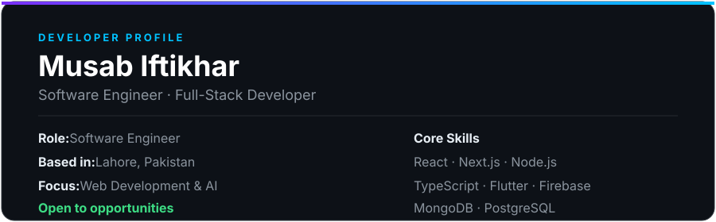

<!-- ================= HEADER ================= -->

  

  
  
  

  <a href="#about"><b>About</b></a> &nbsp;·&nbsp;
  <a href="#tech-stack"><b>Tech Stack</b></a> &nbsp;·&nbsp;
  <a href="#projects"><b>Projects</b></a> &nbsp;·&nbsp;
  <a href="#stats"><b>Stats</b></a> &nbsp;·&nbsp;
  <a href="#goals"><b>Goals</b></a> &nbsp;·&nbsp;
  <a href="#connect"><b>Connect</b></a>

---

<!-- ================= ABOUT ================= -->

## 👋 About Me

I'm a Software Engineering student at **Superior University, Lahore** (2023–2027) who loves building for the web. I learn best by breaking things, then fixing them better, and I'm looking for an internship where I can ship real features and grow with a team.

  

| | |
|---|---|
| 🌍 **Based in** | Lahore, Pakistan |
| 💻 **Building** | Real-world full-stack web projects |
| 🔭 **Learning** | Data Structures & Algorithms, AI / ML fundamentals |
| 💬 **Ask me about** | React, Next.js, JavaScript / TypeScript, Web Development |
| 🤝 **Open to** | Internships & collaboration |
| 📫 **Reach me** | [musabiftikhar44@gmail.com](mailto:musabiftikhar44@gmail.com) |

---

<!-- ================= TECH STACK ================= -->

## 🧰 Tech Stack

<table align="center">
<tr>
<td align="center" width="170"><b>Languages</b></td>
<td></td>
</tr>
<tr>
<td align="center"><b>Frontend</b></td>
<td></td>
</tr>
<tr>
<td align="center"><b>Backend</b></td>
<td></td>
</tr>
<tr>
<td align="center"><b>Databases</b></td>
<td></td>
</tr>
<tr>
<td align="center"><b>Mobile & Cloud</b></td>
<td></td>
</tr>
<tr>
<td align="center"><b>Tools</b></td>
<td></td>
</tr>
</table>

---

<!-- ================= PROJECTS ================= -->

## 🚀 Featured Projects

<!-- TO SHOW YOUR BEST PROJECTS: replace YOUR_REPO_1 and YOUR_REPO_2 with real repo names, then delete this comment's opening line and the closing line after the block.

  
  

-->

  

---

<!-- ================= STATS ================= -->

## 📊 GitHub Stats

  
  

  

  

<!-- Optional: WakaTime weekly coding activity needs a WakaTime account plus the waka-readme GitHub Action to auto-update. Guide: https://github.com/athul/waka-readme -->

🐍 <b>Contribution snake</b>

 

  

---

<!-- ================= GOALS ================= -->

## 🎯 Goals

- [x] Learn the fundamentals of Full-Stack Development
- [ ] Master Data Structures & Algorithms
- [ ] Build 10+ professional-grade projects
- [ ] Contribute to Open Source
- [ ] Learn AI & Machine Learning
- [ ] Land a Software Engineering internship

---

<!-- ================= CONNECT ================= -->

## 🌐 Let's Connect

Got an internship, an idea, or a project to build together? My inbox is open.

<!-- Optional: Buy Me a Coffee / Ko-fi — add your real handle to enable

-->

<!-- ================= FOOTER ================= -->

  

