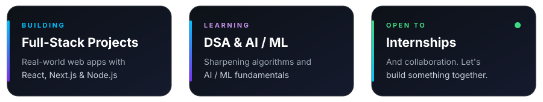

<!-- ================= HEADER ================= -->

  

  

  
  
  
  

  <a href="#about"><b>About</b></a> &nbsp;·&nbsp;
  <a href="#tech-stack"><b>Tech Stack</b></a> &nbsp;·&nbsp;
  <a href="#projects"><b>Projects</b></a> &nbsp;·&nbsp;
  <a href="#stats"><b>Stats</b></a> &nbsp;·&nbsp;
  <a href="#goals"><b>Goals</b></a> &nbsp;·&nbsp;
  <a href="#connect"><b>Connect</b></a>

<!-- ================= ABOUT ================= -->

<h2 align="center">👋 About Me</h2>

  I'm a <b>Software Engineering student</b> at <b>Superior University, Lahore</b> (2023–2027) who loves building for the web. 
  I learn best by <i>breaking things, then fixing them better</i>, and I'm looking for an internship 
  where I can ship real features and grow with a team.

  

  

<table align="center">
<tr><td>🌍 <b>Based in</b></td><td>Lahore, Pakistan</td></tr>
<tr><td>🎓 <b>Education</b></td><td>BS Software Engineering, Superior University (2023–2027)</td></tr>
<tr><td>💬 <b>Ask me about</b></td><td>React, Next.js, JavaScript / TypeScript, Web Development</td></tr>
<tr><td>📫 <b>Reach me</b></td><td><a href="mailto:musabiftikhar44@gmail.com">musabiftikhar44@gmail.com</a></td></tr>
</table>

<!-- ================= TECH STACK ================= -->

<h2 align="center">🧰 Tech Stack</h2>

<table align="center">
<tr>
<td align="center" width="170"><b>Languages</b></td>
<td></td>
</tr>
<tr>
<td align="center"><b>Frontend</b></td>
<td></td>
</tr>
<tr>
<td align="center"><b>Backend</b></td>
<td></td>
</tr>
<tr>
<td align="center"><b>Databases</b></td>
<td></td>
</tr>
<tr>
<td align="center"><b>Mobile & Cloud</b></td>
<td></td>
</tr>
<tr>
<td align="center"><b>Tools</b></td>
<td></td>
</tr>
</table>

  
  
  
  

<!-- ================= PROJECTS ================= -->

<h2 align="center">🚀 Featured Projects</h2>

<!-- TO SHOW YOUR BEST PROJECTS: replace YOUR_REPO_1 and YOUR_REPO_2 with real repo names, then delete this comment's opening line and the closing line after the block.

  
  

-->

  

<!-- ================= STATS ================= -->

<h2 align="center">📊 GitHub Stats</h2>

  
  

  

  

<h3 align="center">🏆 Trophy Case</h3>

  

<h3 align="center">🐍 Contribution Snake</h3>

  

<!-- Optional: WakaTime weekly coding activity needs a WakaTime account plus the waka-readme GitHub Action to auto-update. Guide: https://github.com/athul/waka-readme -->

  

<!-- ================= GOALS ================= -->

<h2 align="center">🎯 Current Goals</h2>

<table align="center">
<tr><td>✅</td><td><b>Learn the fundamentals of Full-Stack Development</b></td></tr>
<tr><td>🧩</td><td>Master Data Structures & Algorithms</td></tr>
<tr><td>🏗️</td><td>Build 10+ professional-grade projects</td></tr>
<tr><td>🌍</td><td>Contribute to Open Source</td></tr>
<tr><td>🤖</td><td>Learn AI & Machine Learning</td></tr>
<tr><td>💼</td><td><b>Land a Software Engineering internship</b></td></tr>
</table>

<!-- ================= CONNECT ================= -->

<h2 align="center">🌐 Let's Connect</h2>

<i>Got an internship, an idea, or a project to build together? My inbox is open. 📬</i>

<!-- Optional: Buy Me a Coffee / Ko-fi — add your real handle to enable

-->

<!-- ================= FOOTER ================= -->

  

  

